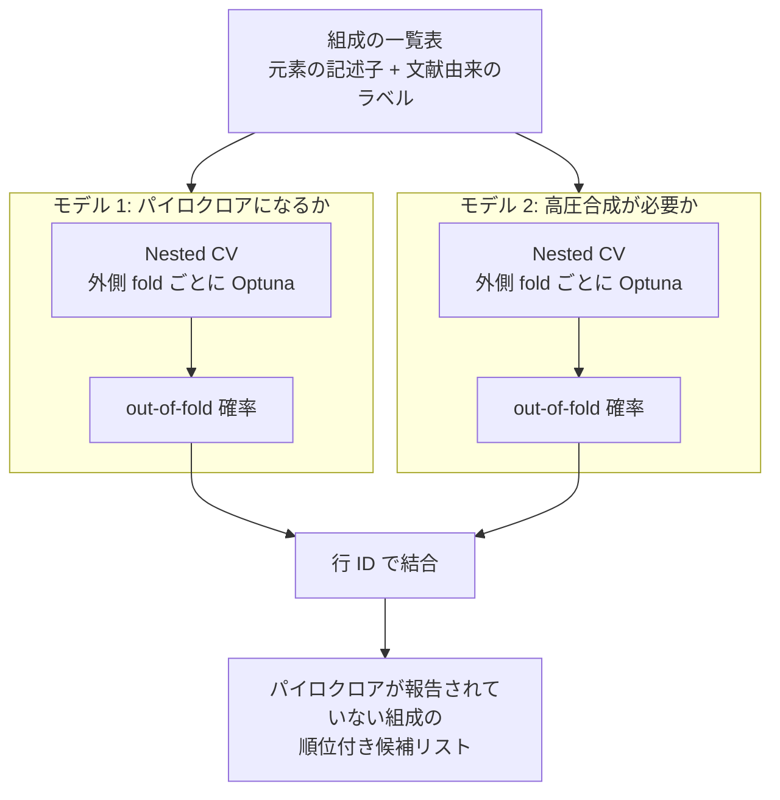

# pyrochlore-discovery-ml

[English README](README.md)

**「どの元素の組み合わせなら、ある結晶構造を作れるか」を機械学習で予測し、合成を試す価値のある新物質の候補を絞り込む**パイプラインです。

対象はパイロクロア型酸化物（組成式 A₂B₂O₇）で、磁性・超伝導・イオン伝導などの研究対象になっている物質群です。A と B に入る元素の組み合わせは多数考えられますが、実際に合成が報告されているのはその一部です。合成実験は 1 回に数日かかり、数万気圧の高圧をかけて初めて得られるものもあります。このパイプラインは、まだ試されていない組み合わせに順位を付け、有望なものから実験できるようにします。

> **データと結果について。** このリポジトリは、進行中の未発表研究で使っているコードです。文献から集めたデータセット、学習済みモデル、性能の数値、候補物質のリストは**意図的に含めていません**。代わりに合成データの生成スクリプトを用意してあり、パイプライン全体を通しで動かせます。合成データから出てくるものは動作確認用であり、研究結果ではありません。

## パイプラインの流れ



1. **特徴量の作成**: 各組成を、構成する 2 つの元素の性質（イオン半径、電気陰性度、電子数など）とその和・差で表します。
2. **モデル 1（`np_p`）**: 「パイロクロアになる」か「未報告／ならない」かを分類するランダムフォレスト。
3. **モデル 2（`ap_hp`）**: 既知のパイロクロアだけで学習し、「常圧で合成できる」か「高圧が必要」かを分類するランダムフォレスト。
4. **評価**: どちらも繰り返し nested cross-validation で評価し、指標は out-of-fold 予測だけから計算します。
5. **候補抽出**: パイロクロアが報告されていない組成（未報告、または合成に失敗したと報告済み）をモデル 1 の確率が高い順に並べ、モデル 2 の「高圧が必要な確率」を添えます。

2 つの確率を合わせて読むと、その組成が「常圧で得られそう」「高圧でなら得られそう（準安定相）」「できそうにない」のどれに近いかが分かります。実験する側が「何を、どの装置で試すか」を決めるのに必要な情報です。パイプラインは 2 つの確率を並べて出力し、1 つの 3 クラスのラベルにはまとめません。

## 設計上の判断

データは小さく、ラベルも不完全です。そのため、モデルそのものよりも「評価の数字を信用できるものにする」ことに工夫の大半を割いています。

| 問題 | コードでの対処 |
| --- | --- |
| 同じ分割でチューニングと評価をすると、スコアが実力より高く出る | **Nested CV**（[src/cv.py](src/cv.py)）。ハイパーパラメータは外側の学習 fold の中だけで Optuna が決め、外側のテスト fold はチューニング中に一切見ません。 |
| 最終モデルは学習した行を記憶している | 学習に使った行には必ず **out-of-fold の確率**を使い、最終モデルの確率は学習に使っていない行にだけ使います。学習行が 1 行でも最終モデルの確率に落ちる場合は、エラーで止めます（[src/predictor.py](src/predictor.py)）。 |
| 「未報告」は「作れない」と同じではない | 負例の大半はラベルなし（positive-unlabeled の状況）です。そのためモデル 1 は正解率ではなく、**順位付けの良さ**（average precision、上位 N% の的中率）で評価します。 |
| 2 つのモデルは使い方が違う | モデル 1 は候補を並べるのが目的なので **average precision** でチューニングします。モデル 2 は確率の値そのものを候補ごとに読むので、proper scoring rule である **Brier score** でチューニングし、較正曲線で確認します。 |
| しきい値は用途ごとに違う | 報告する指標は 0.5、候補抽出は見逃しを減らすために別の低いしきい値を使います。実行のたびに**しきい値スイープ表**を出力します（[src/evaluate.py](src/evaluate.py)）。 |
| 設定の書き忘れは静かに別条件で走る | モデルごとの設定は、デフォルトとのマージをせず完全な形で書きます。実行前に **config を検査**し、キーが欠けていれば止めます。欠けたままだと scikit-learn のデフォルト値で動いてしまい、後から気づけないためです（[src/main.py](src/main.py)）。 |
| 組成式は一意なキーにならない | 同じ組成式が価数の割り当て違いで 2 行あり得るので、明示的な `row_id` をキーにし、読み込み時に一意性を検査します（[src/data.py](src/data.py)）。 |
| 予測の根拠を見たい | 特徴量重要度を外側 fold 全体で集計（平均 ± 標準偏差）し、最終モデルについて SHAP の図を出します（[src/explain.py](src/explain.py)）。 |

## 動かし方（合成データ）

conda または mamba が必要です。デモの実行はノート PC で 1 分程度です。

```bash
mamba env create -f environment.yml
conda activate pyrochlore-discovery-ml
cp .env.example .env

python scripts/make_demo_data.py          # ml_data/data/processed/demo_dataset.csv を生成
python run_one.py config/active/demo.yaml # 2 つのモデルを通しで実行
```

生成スクリプトは架空の元素と単純なラベル付けルールを使いますが、実データの扱いにくい点は再現しています。負例の大半がラベルなしであること、組成式の重複、価数が決まらない行、学習には使えず推論だけ行う行、の 4 つです。

出力は `ml_data/outputs/demo/` に書かれます。

```text
results/
  predictions_all_demo.csv        入力の全行と 2 モデルの確率
                                  （読み込み時に除外した行の確率は空欄）
  new_pyro_candidates_demo.csv    順位付きの候補リスト
NP-Pyro/ と AP-HP/                モデルごとのディレクトリ
  results/   oof_predictions、fold 別・repeat 別・まとめの指標、
             threshold_sweep、fold ごとの best_params、特徴量重要度
  figures/   ROC、PR 曲線、較正曲線、混同行列、
             特徴量重要度、Optuna の履歴、SHAP
  pkl/       最終モデルと Optuna の study
```

`python src/main.py` は `config/active/` にある config を順に実行します。本番規模の設定（外側 5×5 fold、fold ごとに Optuna 500 trials）は [config/examples/production_like.yaml](config/examples/production_like.yaml) にあります。

## 自分のデータで使う

config の `dataset_path` を、組成式を index とする CSV に向けます。必要な列は次のとおりで、これに加えて `selected_descriptors` に書いた数値の記述子列が必要です。

| 列 | 意味 |
| --- | --- |
| `A`, `B`, `nA`, `nB` | A サイト・B サイトの元素と価数 |
| `exp_label` | 0 = 未報告、1 = パイロクロアにならないと報告済み、2〜6 = パイロクロアとその亜種（すべて陽性として扱う） |
| `HPS` | 合成圧力。0 = 得られていない、1〜2 = 常圧・低圧、3 = 高圧 |
| `t` | 幾何学的なトレランスファクター。欠損している行は学習に使わず、推論だけ行う |
| `A-site_atomic_number`, `B-site_atomic_number`, `atomic_number_sum` | 対象外の重元素を除くために使う |

## ディレクトリ構成

```text
config/
  active/demo.yaml               src/main.py が実行する config
  examples/production_like.yaml  本番規模の設定例
scripts/
  make_demo_data.py              合成データの生成
  reshortlist_candidates.py      再学習せずに、別のしきい値で候補リストを作り直す
src/
  main.py        全体の流れと config の検査
  data.py        読み込み、行 ID、モデルごとのラベル作成
  cv.py          nested cross-validation と out-of-fold の集約
  optimizer.py   Optuna の目的関数（内側 CV）
  model.py       探索空間からモデルを作る単一の窓口
  evaluate.py    out-of-fold 予測からの指標と図
  explain.py     SHAP
  predictor.py   2 モデルの出力の結合と候補抽出
  utils.py       入出力の補助
run_one.py       config を 1 本だけ実行する（config ごとに別プロセスで並列化するため）
```

## 使用技術

Python 3.11 · scikit-learn · Optuna · SHAP · pandas · OmegaConf · matplotlib / seaborn
