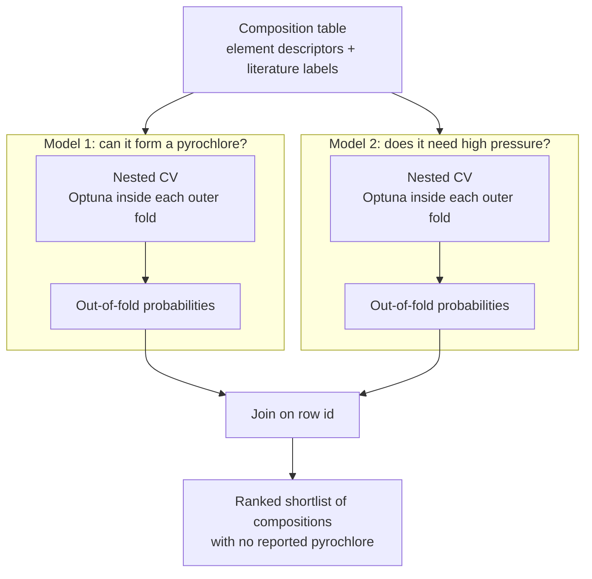

# pyrochlore-discovery-ml

[日本語版 README](README.ja.md)

A machine-learning pipeline that predicts **which chemical compositions can form a given crystal structure** and uses those predictions to **shortlist new materials worth trying to synthesize**.

The target is the pyrochlore oxide family (formula A₂B₂O₇), a class of materials studied for magnetism, superconductivity and ionic conduction. Far more A/B element combinations are conceivable than have ever been reported, and each synthesis attempt costs days of lab work — some only succeed under several gigapascals of pressure. This pipeline ranks the untested combinations so that experiments can start from the most promising ones.

> **About data and results.** This repository is the code of an ongoing, unpublished research project. The literature-derived dataset, the trained models, the performance numbers and the candidate list are intentionally **not included**. A synthetic data generator is provided so the whole pipeline can be run end to end; anything it produces is a smoke test, not a scientific result.

## What the pipeline does



1. **Featurize** each composition with descriptors built from its two elements (ionic radii, electronegativity, electron counts, … and their sums and differences).
2. **Model 1 (`np_p`)** — a random forest classifying *forms a pyrochlore* vs. *not reported / does not form*.
3. **Model 2 (`ap_hp`)** — a second random forest, trained only on known pyrochlores, classifying *ambient-pressure synthesis* vs. *needs high pressure*.
4. **Evaluate** both with repeated nested cross-validation and report metrics from out-of-fold predictions only.
5. **Shortlist** the compositions with no reported pyrochlore (unreported, or reported as failed) that have the highest Model 1 probability, annotated with Model 2's high-pressure probability.

Read together, the two probabilities indicate whether a composition looks obtainable at ambient pressure, obtainable only under high pressure (a metastable phase), or unlikely to form — which is what an experimentalist needs to decide what to try and with which apparatus. The pipeline outputs the two probabilities side by side; it does not collapse them into a single three-class label.

## Design decisions

The dataset is small and the labels are imperfect, so most of the engineering effort went into making the evaluation trustworthy rather than into the model itself.

| Problem | What the code does |
| --- | --- |
| Tuning and evaluating on the same split inflates scores | **Nested CV** ([src/cv.py](src/cv.py)): hyperparameters are tuned by Optuna inside each outer training fold; the outer test fold is never seen during tuning. |
| A final model has memorized its training rows | Every training row gets its **out-of-fold probability**; the final model is only used for rows that were never trained on. The pipeline raises if any training row would silently fall back to the final model ([src/predictor.py](src/predictor.py)). |
| "Not reported" is not the same as "impossible" | Negatives are mostly *unlabeled* (a positive-unlabeled setting). Model 1 is therefore judged as a **ranker** — average precision and precision-at-top-N% — not by accuracy. |
| The two models are used differently | Model 1 ranks candidates, so it is tuned on **average precision**. Model 2's probability is read as a number per candidate, so it is tuned on the **Brier score** (a proper scoring rule) and checked with a calibration plot. |
| One threshold does not fit every purpose | Reported metrics use 0.5; the shortlist uses its own, lower threshold to favor recall. A **threshold sweep** table is written for every run ([src/evaluate.py](src/evaluate.py)). |
| Config mistakes fail silently | Per-model settings are written out in full with no default merging, and the config is **validated before anything runs** — a missing key would otherwise fall back to a scikit-learn default unnoticed ([src/main.py](src/main.py)). |
| Formulas are not unique keys | The same formula can appear with two different valence assignments, so rows are keyed by an explicit `row_id`, and uniqueness is asserted at load time ([src/data.py](src/data.py)). |
| Interpretability | Feature importances are aggregated over outer folds (mean ± std), and SHAP plots are produced for the final model ([src/explain.py](src/explain.py)). |

## Quickstart (synthetic data)

Requires conda or mamba. A full demo run takes about one minute on a laptop.

```bash
mamba env create -f environment.yml
conda activate pyrochlore-discovery-ml
cp .env.example .env

python scripts/make_demo_data.py          # writes ml_data/data/processed/demo_dataset.csv
python run_one.py config/active/demo.yaml # runs both models end to end
```

The generator uses fictitious elements and a toy labeling rule, but reproduces the awkward properties of the real table: mostly-unlabeled negatives, duplicated formulas, rows with unknown valence, and rows that can only be predicted, not trained on.

Outputs are written under `ml_data/outputs/demo/`:

```text
results/
  predictions_all_demo.csv        every input row with both models' probabilities
                                  (blank for rows excluded at load time)
  new_pyro_candidates_demo.csv    the ranked shortlist
NP-Pyro/  and  AP-HP/             one directory per model
  results/   oof_predictions, metrics per fold / per repeat / summary,
             threshold_sweep, best_params per fold, feature importances
  figures/   ROC, precision-recall, calibration, confusion matrix,
             feature importance, Optuna history, SHAP
  pkl/       final model and Optuna study
```

`python src/main.py` runs every config in `config/active/` in sequence. [config/examples/production_like.yaml](config/examples/production_like.yaml) shows full-scale settings (5×5 outer folds, 500 Optuna trials per fold).

## Using your own data

Point `dataset_path` in a config at a CSV indexed by formula, with these columns plus any numeric descriptor columns listed under `selected_descriptors`:

| Column | Meaning |
| --- | --- |
| `A`, `B`, `nA`, `nB` | A-site / B-site elements and their valences |
| `exp_label` | 0 = unreported, 1 = reported not to form, 2–6 = pyrochlore and its variants (all treated as positive) |
| `HPS` | synthesis pressure: 0 = not obtained, 1–2 = ambient / low pressure, 3 = high pressure |
| `t` | a geometric tolerance factor; rows where it is missing are predicted but not trained on |
| `A-site_atomic_number`, `B-site_atomic_number`, `atomic_number_sum` | used to drop out-of-scope heavy elements |

## Repository layout

```text
config/
  active/demo.yaml               configs picked up by src/main.py
  examples/production_like.yaml  full-scale settings
scripts/
  make_demo_data.py              synthetic dataset generator
  reshortlist_candidates.py      rebuild the shortlist at another threshold without retraining
src/
  main.py        orchestration and config validation
  data.py        loading, row ids, label construction per model
  cv.py          nested cross-validation, out-of-fold aggregation
  optimizer.py   Optuna objective (inner CV)
  model.py       single entry point for building models from a param space
  evaluate.py    metrics and figures from out-of-fold predictions
  explain.py     SHAP
  predictor.py   merging both models' outputs, shortlist extraction
  utils.py       I/O helpers
run_one.py       run a single config (one process per config to parallelize)
```

Code comments and log messages are in Japanese.

## Stack

Python 3.11 · scikit-learn · Optuna · SHAP · pandas · OmegaConf · matplotlib / seaborn
